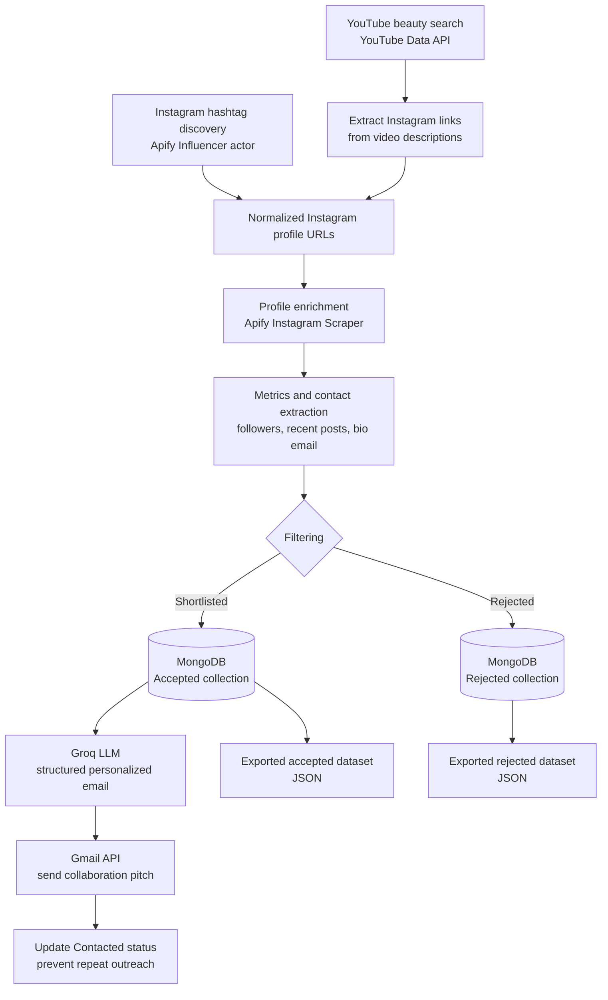
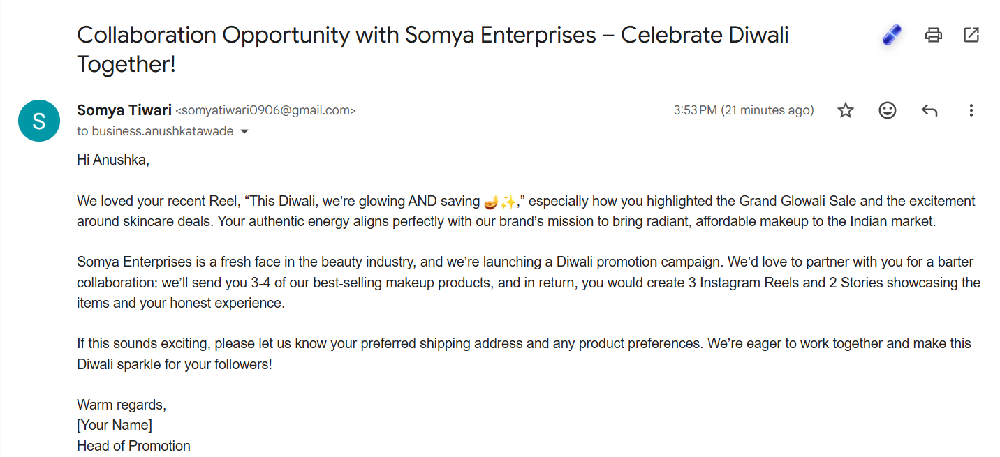

# Automated Micro Influencer Outreach System

An AI-assisted workflow for finding Indian beauty and skincare micro-influencers, evaluating their public Instagram profiles, capturing public contact details, generating tailored collaboration emails, and delivering those emails through Gmail.

The project is built as an internship assignment prototype for Somya Enterprises, a beauty brand planning a barter-based Diwali promotion campaign. It focuses on transparent public-profile data: missing public emails and unavailable metrics are recorded rather than guessed.

## What the system does

1. Discovers relevant Instagram creators from beauty-focused hashtags through Apify.
2. Uses the YouTube Data API to find Indian beauty-content videos and extracts Instagram links from public video descriptions.
3. Normalizes Instagram profile URLs and retrieves profile details and recent posts through Apify's Instagram Scraper.
4. Calculates engagement from up to five recent posts and filters creators by profile metrics.
5. Extracts only publicly listed emails from Instagram biographies. Profiles without an email are retained as `Not found`; no email address is invented.
6. Stores accepted and rejected profiles separately in MongoDB, including rejection reasons.
7. Uses Groq with a structured-output Pydantic schema to generate a personalized email subject and body from the creator's name, public email, and latest Reel caption.
8. Sends eligible messages through the Gmail API and marks a MongoDB record as contacted after a successful send.

## Architecture



## Delivery evidence

The following test email shows a personalized barter-collaboration pitch delivered through the Gmail sending layer. It references the recipient's recent Diwali Reel and proposes the campaign deliverables.



## Data and filtering

The repository includes the current exported workflow results:

| Dataset | Records | Purpose |
| --- | ---: | --- |
| `Influencer_data.Accepted.json` | 46 | Profiles that passed the workflow's current filtering path and were written to the accepted collection. |
| `Influencer_data.Rejected.json` | 104 | Profiles excluded for follower-count and/or engagement criteria, with the reason retained. |

The accepted export contains 27 profiles with a publicly listed email and 19 profiles where the public bio did not expose an email. The latter remain valid discovery records but are excluded from automated Gmail sending.

### Current decision rules

- **Niche discovery:** Indian beauty, makeup, skincare, GRWM, and Delhi beauty-blogger queries/hashtags.
- **Followers:** configured at 5,000 minimum and 250,000 maximum in the current implementation.
- **Engagement:** average `(likes + comments) / followers` across up to five usable recent posts; profiles below 1% are normally rejected.
- **Missing metrics:** when engagement cannot be computed because recent post counts are unavailable, the profile is retained with an unavailable engagement value instead of a fabricated metric.
- **Email:** public biography emails are extracted with a regular expression; otherwise the stored contact value is `Not found`.

## Personalized outreach

For every accepted profile that has a public email and has not already been contacted, the workflow asks Groq for one strict JSON response:

```json
{
  "to": "creator@example.com",
  "subject": "Personalized campaign subject",
  "body": "Personalized collaboration email"
}
```

The LLM prompt provides the creator's name and latest Reel caption and requests a professional, non-generic barter offer: 3–4 makeup products in exchange for 3 Instagram Reels and 2 Stories. Pydantic validates the response structure before Gmail is called.

No Instagram DMs are sent automatically. Direct Instagram messaging is intentionally outside this prototype's sending layer; profiles without a public email can be handled through a manual DM/review process.

## Technology stack

| Area | Tools |
| --- | --- |
| Orchestration | LangGraph with SQLite checkpointing |
| Instagram discovery and enrichment | Apify client, Influencer actor, Instagram Scraper actor |
| Supplementary discovery | YouTube Data API v3 |
| Database | MongoDB (`Influencer_data`) |
| AI personalization | Groq, LangChain, Pydantic structured output |
| Email delivery | Gmail API with OAuth 2.0 |
| Language | Python |

## Project structure

```text
assignment1/
├── backend.py                         # LangGraph workflow and email-personalization node
├── src/tools.py                       # Discovery, enrichment, filtering, MongoDB, Gmail helpers
├── Influencer_data.Accepted.json       # Exported shortlisted records
├── Influencer_data.Rejected.json       # Exported rejected records and reasons
├── assets/promotion-email-sent.png     # Gmail delivery evidence
├── requirements.txt                    # Python dependencies
├── gmail_api_secrets.json              # Local OAuth client secret (not committed)
└── token.json                          # Local Gmail OAuth token (not committed)
```

## Setup

### Prerequisites

- Python 3.13 or a compatible Python version
- MongoDB running locally on `mongodb://localhost:27017/`
- An Apify token with access to the selected actors
- A YouTube Data API key
- A Groq API key
- A Google Cloud OAuth client configured for Gmail API sending

### Install

```powershell
python -m venv .venv
.\.venv\Scripts\Activate.ps1
pip install -r requirements.txt
```

Create a `.env` file in the project root:

```env
APIFY_API_TOKEN=your_apify_token
YT_API_KEY=your_youtube_data_api_key
GROQ_API_KEY=your_groq_api_key
```

Place the downloaded Google OAuth client configuration at `gmail_api_secrets.json`. On the first send, the Gmail OAuth flow opens in a browser and writes a local `token.json` file.

## Run the workflow

Start MongoDB, activate the virtual environment, and run:

```powershell
python backend.py
```

The workflow performs discovery, enrichment, filtering, database writes, LLM personalization, and email sending in one run. Use a test mailbox and review the targeting criteria before production use: this command can send real emails to eligible public contact addresses.

## Database collections and idempotency

MongoDB database `Influencer_data` uses two collections:

- `Accepted`: shortlisted profile fields including URL, creator name, followers, public contact, calculated engagement, latest Reel caption, and `Contacted` state.
- `Rejected`: profile URL, creator name, and the stored follower/engagement rejection values.

The sending query selects records where `Contacted` is `False` and `contact` is not `Not found`. After Gmail successfully sends the generated message, the record is updated to `Contacted: True`, preventing the same accepted record from being selected in the next sending pass.

## Validation

The Python source has been syntax-checked with:

```powershell
.\Scripts\python.exe -m py_compile backend.py src\tools.py
```
